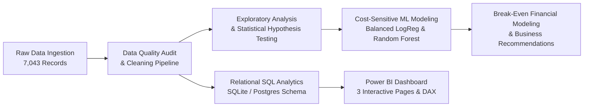
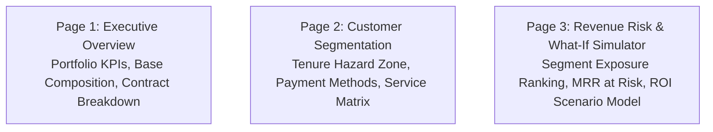

# Customer Retention & Revenue Risk Analytics

[](https://www.python.org/)
[](https://sqlite.org/)
[](https://powerbi.microsoft.com/)
[](tests/)
[](LICENSE)

An enterprise-grade, end-to-end data analytics and predictive modeling project examining customer attrition dynamics, contractual friction, early-tenure onboarding hazards, and monthly recurring revenue (MRR) risk exposure. 

Designed for high-impact portfolio presentation, technical depth, and executive communication.

---

## Executive Summary & Core Results

Using the canonical IBM Telco customer dataset (**7,043 customer accounts**), this project quantifies the structural drivers of customer attrition and evaluates the financial return of targeted retention interventions.



### Key Portfolio Metrics

| Metric | Measured Value | Business Interpretation |
|---|---|---|
| **Total Customer Base** | 7,043 | Active and recently severed customer accounts |
| **Retained Customers** | 5,174 (73.46%) | Stable account baseline |
| **Churned Customers** | 1,869 (26.54%) | Accounts lost in previous reporting cycle |
| **Total Monthly Billings** | $456,116.60 | Aggregate portfolio monthly recurring billing volume |
| **Monthly Revenue Exposure Proxy** | **$139,130.85** | **30.50% of monthly billings lost to churned accounts** |
| **Annualized Run-Rate Exposure** | **$1,669,570.20** | Annualized proxy ($139,130.85 × 12 months) |
| **Total Historical Realized Revenue** | $16,056,168.70 | Cumulative customer lifetime spend across all accounts |

> [!IMPORTANT]
> **Revenue Exposure Definition & Caveat**:
> Monthly charges are utilized as an operational proxy for **Monthly Recurring Revenue (MRR) Exposure**. This metric represents the top-line billing volume associated with severed accounts. It is *not* identical to net lost cash flow, as it excludes customer acquisition costs (CAC), gross margin margins, contractual termination penalties, promotional credits, and future expansion value.

---

## 1. Problem Statement & Business Objective

Telecommunications providers face substantial customer churn, where account loss immediately erodes recurring revenue and escalates customer acquisition overhead. 

The primary business objectives of this study are:
1. **Identify High-Attrition Customer Cohorts**: Diagnose the root operational, contractual, and service features associated with churn.
2. **Quantify Financial Risk**: Distinguish historical realized cash flow from recurring monthly billing exposure at risk.
3. **Build Leak-Free Predictive Models**: Move beyond misleading classification accuracy by optimizing decision thresholds for commercial retention campaign ROI.
4. **Formulate Tested Break-Even Recommendations**: Model the exact customer recovery threshold required to make proactive retention interventions profitable.

---

## 2. Dataset Provenance & Data Quality Protocol

- **Dataset Name**: IBM Telco Customer Churn Dataset (`Telco-Customer-Churn.csv`)
- **Canonical Repository**: [IBM/telco-customer-churn-on-icp4d](https://github.com/IBM/telco-customer-churn-on-icp4d)
- **Direct Source URL**: `https://raw.githubusercontent.com/IBM/telco-customer-churn-on-icp4d/master/data/Telco-Customer-Churn.csv`
- **License / Usage**: Apache License 2.0 / Public Sample Dataset.
- **Population**: Cross-sectional sample of 7,043 telecommunications customers in California providing phone and Internet services.

### Data Cleaning Decisions & Quality Audit
1. **Handling Whitespace in `TotalCharges` (11 Records)**:
   - *Observation*: 11 rows in `TotalCharges` contained blank whitespace (`" "`), causing the column to import as a string `object`.
   - *Diagnosis*: Cross-tabulation confirmed all 11 records have `tenure == 0` and `Churn == "No"`. These represent newly onboarded accounts that have not completed their first billing cycle.
   - *Action*: Imputed with `0.00` and cast to `float64`. This preserves the entire 7,043 account population without discarding newly acquired customers or introducing synthetic noise.
2. **Zero Nulls & Zero Duplicates**:
   - Zero missing values across all other 20 features.
   - Zero duplicate `customerID` records (7,043 unique alphanumeric accounts).
3. **Class Imbalance Audit**:
   - Retained (`No`): 5,174 (73.46%)
   - Churned (`Yes`): 1,869 (26.54%)
   - Baseline Churn Rate: **26.54%**.

Comprehensive documentation is provided in [`data/README.md`](data/README.md).

---

## 3. Technology Stack

- **Python 3.14+**:
  - `pandas` & `numpy`: Data manipulation, cohort grouping, array operations.
  - `scipy`: Statistical hypothesis testing (Chi-Square, Welch's t-test, Mann-Whitney U).
  - `scikit-learn`: Data preprocessing pipelines (`ColumnTransformer`, `StandardScaler`, `OneHotEncoder`), stratified cross-validation, logistic regression, random forest classifiers.
  - `matplotlib` & `seaborn`: High-resolution diagnostic visualizations (300 DPI).
  - `pytest`: Automated data quality, business logic, and SQL consistency testing.
- **SQL (SQLite & PostgreSQL ANSI)**:
  - Database schema, table constraints, automated data quality assertions, window functions (`DENSE_RANK()`, `SUM() OVER`), and CTE risk indices.
- **Power BI Desktop**:
  - Multi-page interactive dashboard, DAX measures, dimension modeling, and retention ROI sensitivity simulator.
- **Git & GitHub**:
  - Version control with modular, verifiable commits and full documentation.

---

## 4. Repository Structure

```
customer-retention-revenue-risk/
├── README.md                              # Portfolio documentation & business report
├── requirements.txt                       # Python dependencies
├── .gitignore                             # Ignored files, temp binaries, and caches
├── data/
│   ├── raw/
│   │   └── Telco-Customer-Churn.csv       # Unmodified raw source dataset
│   ├── processed/
│   │   ├── telco_churn_cleaned.csv        # Cleaned dataset (7,043 rows)
│   │   └── telco_churn_powerbi.csv        # Enriched dataset with analytical cohorts
│   └── README.md                          # Data dictionary and provenance documentation
├── notebooks/
│   └── customer_churn_analysis.ipynb      # Interactive Jupyter analysis notebook
├── src/
│   ├── __init__.py                        # Package initialization
│   ├── data_cleaning.py                   # Ingestion, validation, and SQLite loader
│   ├── exploratory_analysis.py            # High-resolution figure generator
│   ├── run_sql_analytics.py               # Automated SQL query execution & validation
│   ├── statistical_analysis.py            # Hypothesis testing & effect size calculations
│   ├── churn_model.py                     # ML pipeline, cross-validation & threshold tuning
│   └── generate_notebook.py               # Reproducible notebook generator
├── sql/
│   ├── schema.sql                         # Table DDL, constraints, and index definitions
│   ├── data_quality_checks.sql            # Automated SQL integrity assertions
│   └── retention_analysis.sql             # Analytical queries, window functions & CTEs
├── reports/
│   ├── figures/                           # 9 High-resolution publication figures (300 DPI)
│   │   ├── 01_churn_distribution.png
│   │   ├── 02_churn_by_contract.png
│   │   ├── 03_tenure_distribution_by_churn.png
│   │   ├── 04_monthly_charges_distribution.png
│   │   ├── 05_churn_by_internet_techsupport.png
│   │   ├── 06_churn_by_payment_method.png
│   │   ├── 07_roc_pr_curves.png
│   │   ├── 08_feature_importance.png
│   │   └── 09_threshold_tradeoff.png
│   ├── findings.md                        # Strategic business findings & financial analysis
│   ├── model_evaluation_metrics.json      # Machine-readable model metrics
│   ├── model_results.txt                  # Model benchmarks and threshold summary
│   ├── statistical_tests.txt              # Statistical test outputs and p-values
│   └── sql_query_results.txt              # Verified SQL execution outputs
├── powerbi/
│   ├── README.md                          # Complete dashboard implementation guide
│   ├── dax_measures.dax                   # Tested DAX measures
│   └── data_model_documentation.md        # Star-schema design & sorting rules
└── tests/
    ├── __init__.py
    └── test_data_quality.py               # 13 automated Pytest test cases
```

---

## 5. Local Setup & Execution Guide

### Step 1: Clone Repository and Set Up Python Environment
```bash
# Clone the repository
git clone https://github.com/your-username/customer-retention-revenue-risk.git
cd customer-retention-revenue-risk

# Create and activate virtual environment (Windows PowerShell)
python -m venv venv
venv\Scripts\activate

# Install required dependencies
pip install -r requirements.txt
```

### Step 2: Run End-to-End Analytics Pipeline
All scripts run seamlessly from the repository root:

```bash
# 1. Clean data, validate anomalies, and populate SQLite database
python src/data_cleaning.py

# 2. Generate publication-quality figures in reports/figures/
python src/exploratory_analysis.py

# 3. Execute and validate SQL queries against SQLite database
python src/run_sql_analytics.py

# 4. Perform statistical hypothesis tests (Chi-Square & Welch's t-test)
python src/statistical_analysis.py

# 5. Train predictive models, run 5-fold CV, and optimize decision threshold
python src/churn_model.py

# 6. Execute automated pytest suite
pytest -v tests/
```

---

## 6. Key Analytical Findings

### 1. The Contract Commitment Chasm
- **Month-to-Month Contracts**: Represent 55.02% of all accounts (3,875 accounts) but account for **86.86% of all monthly churn exposure** ($120,847.10 / $139,130.85).
  - Churn Rate: **42.71%** (1,655 churned accounts).
- **One-Year Contracts**: Churn rate drops to **11.27%** (166 churned accounts).
- **Two-Year Contracts**: Churn rate plunges to **2.83%** (48 churned accounts).
- **Statistical Significance**: $\chi^2 = 1,184.60$ ($p = 5.86 \times 10^{-258}$, Cramér's $V = 0.4098$, Substantial effect size). Month-to-month subscribers exhibit **15.1x higher churn propensity** than two-year contract holders.

### 2. The Early-Tenure Hazard Zone
- Customers in their **first 12 months (0–12 Mo)** experience a **47.44% churn rate** (1,037 churned out of 2,186 accounts).
- Specifically, **Month-to-Month accounts in their first year** suffer a **51.35% churn rate** (1,024 churned out of 1,994 accounts), exposing **$68,301.45/month** (49.09% of all portfolio churn exposure).
- Retention stabilizes dramatically after Month 24:
  - 13–24 Months: 28.71% churn rate
  - 25–48 Months: 20.39% churn rate
  - 49–60 Months: 14.42% churn rate
  - 61–72 Months: 6.61% churn rate
- **Statistical Significance**: Welch's $t = -34.82$ ($p = 1.20 \times 10^{-232}$, Cohen's $d = -0.8522$, Large effect size). Median tenure of retained customers is 38 months vs. 10 months for churned accounts.

### 3. Payment Gateway Friction
- **Electronic Check Users**: 2,365 accounts (33.58% of base) exhibit an alarming **45.29% churn rate** (1,071 churned), generating **$79,856.90 in monthly revenue exposure** (57.40% of all portfolio churn exposure).
- Automated payment mechanisms exhibit roughly one-third the churn:
  - Bank Transfer (Automatic): **16.71% churn rate**
  - Credit Card (Automatic): **15.24% churn rate**
  - Mailed Check: **19.11% churn rate**
- **Statistical Significance**: $\chi^2 = 648.14$ ($p = 3.68 \times 10^{-140}$, Cramér's $V = 0.3027$, Substantial effect size).

### 4. Technical Support as a Retention Anchor
- **Fiber Optic Attrition**: Fiber optic subscribers suffer a **41.89% churn rate** (1,297 / 3,096 accounts) compared to **18.96%** for DSL subscribers.
- **Tech Support Impact**: Customers lacking Tech Support have a **41.64% churn rate** (1,446 / 3,473 accounts), whereas customers with active Tech Support churn at only **15.17%** (310 / 2,044 accounts).
- **The "High-Risk Toxic Quad"**:
  Customers with *Month-to-Month Contract + High Monthly Charges ($70–$90) + Electronic Check + No Tech Support* exhibit a **62.58% churn rate** (408 churned out of 652 accounts), representing a **Churn Risk Index of 235.8** (135.8% above baseline) and exposing **$32,622.20/month**.

---

## 7. SQL Analytics & Relational Verification

The database layer was constructed in SQLite (`data/processed/telco_churn.db`) and validated against PostgreSQL ANSI standards.

### Sample SQL Query: High-Risk Segment Ranking via Window Functions
```sql
WITH SegmentMetrics AS (
    SELECT 
        Contract,
        InternetService,
        PaymentMethod,
        COUNT(*) AS total_customers,
        SUM(churn_binary) AS churned_customers,
        ROUND(AVG(churn_binary) * 100.0, 2) AS segment_churn_rate_pct,
        ROUND(SUM(MonthlyCharges), 2) AS total_segment_monthly_revenue,
        ROUND(SUM(mrr_exposure_proxy), 2) AS segment_mrr_exposure_proxy
    FROM telco_churn
    GROUP BY Contract, InternetService, PaymentMethod
)
SELECT 
    Contract,
    InternetService,
    PaymentMethod,
    total_customers,
    churned_customers,
    segment_churn_rate_pct,
    segment_mrr_exposure_proxy,
    DENSE_RANK() OVER (ORDER BY segment_mrr_exposure_proxy DESC) AS exposure_rank,
    DENSE_RANK() OVER (ORDER BY segment_churn_rate_pct DESC) AS churn_rate_rank,
    ROUND(SUM(segment_mrr_exposure_proxy) OVER (
        ORDER BY segment_mrr_exposure_proxy DESC
        ROWS BETWEEN UNBOUNDED PRECEDING AND CURRENT ROW
    ), 2) AS cumulative_mrr_exposure,
    ROUND(
        SUM(segment_mrr_exposure_proxy) OVER (
            ORDER BY segment_mrr_exposure_proxy DESC
            ROWS BETWEEN UNBOUNDED PRECEDING AND CURRENT ROW
        ) * 100.0 / (SELECT SUM(mrr_exposure_proxy) FROM telco_churn), 
        2
    ) AS cumulative_pct_of_total_exposure
FROM SegmentMetrics
ORDER BY segment_mrr_exposure_proxy DESC;
```

Full scripts and outputs:
- Schema: [`sql/schema.sql`](sql/schema.sql)
- Data Quality Assertions: [`sql/data_quality_checks.sql`](sql/data_quality_checks.sql)
- Analytical Queries: [`sql/retention_analysis.sql`](sql/retention_analysis.sql)
- Verified Output: [`reports/sql_query_results.txt`](reports/sql_query_results.txt)

---

## 8. Statistical Hypothesis Testing Methodology

Before building predictive models, formal hypothesis tests were executed to differentiate genuine behavioral signals from sample noise.

### Summary of Statistical Hypothesis Tests

| Feature Tested | Variable Type | Test Applied | Test Statistic | p-Value | Effect Size (Metric) | Decision ($\alpha = 0.05$) |
|---|---|---|---|---|---|---|
| **Contract** | Categorical | Chi-Square ($\chi^2$) | 1,184.60 | $5.86 \times 10^{-258}$ | **0.4098** (Cramér's V, Substantial) | Reject $H_0$ |
| **OnlineSecurity** | Categorical | Chi-Square ($\chi^2$) | 850.00 | $2.66 \times 10^{-185}$ | **0.3470** (Cramér's V, Substantial) | Reject $H_0$ |
| **TechSupport** | Categorical | Chi-Square ($\chi^2$) | 828.20 | $1.44 \times 10^{-180}$ | **0.3425** (Cramér's V, Substantial) | Reject $H_0$ |
| **InternetService** | Categorical | Chi-Square ($\chi^2$) | 732.31 | $9.57 \times 10^{-160}$ | **0.3220** (Cramér's V, Substantial) | Reject $H_0$ |
| **PaymentMethod** | Categorical | Chi-Square ($\chi^2$) | 648.14 | $3.68 \times 10^{-140}$ | **0.3027** (Cramér's V, Substantial) | Reject $H_0$ |
| **PaperlessBilling** | Categorical | Chi-Square ($\chi^2$) | 258.28 | $4.07 \times 10^{-58}$ | **0.1911** (Cramér's V, Moderate) | Reject $H_0$ |
| **PhoneService** | Categorical | Chi-Square ($\chi^2$) | 0.92 | $0.3388$ | **0.0000** (Cramér's V, Negligible) | **Fail to Reject $H_0$** |
| **tenure** | Continuous | Welch's t / Mann-Whitney | $t = -34.82$ | $1.20 \times 10^{-232}$ | **-0.8522** (Cohen's d, Large) | Reject $H_0$ |
| **MonthlyCharges** | Continuous | Welch's t / Mann-Whitney | $t = +18.41$ | $8.59 \times 10^{-73}$ | **+0.4463** (Cohen's d, Medium) | Reject $H_0$ |
| **TotalCharges** | Continuous | Welch's t / Mann-Whitney | $t = -18.71$ | $5.90 \times 10^{-75}$ | **-0.4582** (Cohen's d, Medium) | Reject $H_0$ |

Full test logs: [`reports/statistical_tests.txt`](reports/statistical_tests.txt).

---

## 9. Machine Learning & Predictive Modeling

To prevent data leakage, an 80/20 stratified split (`random_state=42`) was performed, and all feature transformers (`StandardScaler`, `OneHotEncoder`) were fit **strictly on training data**.

### Holdout Test Set Performance Comparison ($N = 1,409$)

| Model Architecture | Accuracy | Precision | Recall | F1-Score | ROC-AUC | PR-AUC | Primary Takeaway |
|---|---|---|---|---|---|---|
| **Baseline (Most Frequent)** | 73.46% | 0.00% | 0.00% | 0.0000 | 0.5000 | 0.2654 | Fails entirely on churners; highlights accuracy paradox |
| **Logistic Regression (Balanced)** | 73.81% | 50.43% | **78.34%** | 0.6136 | 0.8417 | 0.6331 | Interpretable odds ratios; catches 293 / 374 holdout churners |
| **Random Forest (Balanced)** | **74.66%** | **51.46%** | **80.21%** | **0.6270** | **0.8429** | **0.6506** | Highest overall recall and AUC; captures service interactions |

### 5-Fold Stratified Cross-Validation on Training Split
- **Logistic Regression (Balanced)**: ROC-AUC = $0.8459 \pm 0.0124$ | F1 = $0.6296 \pm 0.0226$ | Recall = $0.8020 \pm 0.0379$
- **Random Forest (Balanced)**: ROC-AUC = $0.8463 \pm 0.0111$ | F1 = $0.6328 \pm 0.0164$ | Recall = $0.8013 \pm 0.0175$

### Confusion Matrices (Test Set, N = 1,409)
- **Baseline (Most Frequent)**: TN = 1,035 | FP = 0 | FN = 374 | TP = 0
- **Logistic Regression (Balanced)**: TN = 747 | FP = 288 | FN = 81 | TP = 293
- **Random Forest (Balanced)**: TN = 752 | FP = 283 | FN = 74 | TP = 300

### Why Accuracy Alone is Insufficient
In imbalanced business problems, a naive baseline predicting 100% retention achieves **73.46% accuracy** while generating **$0 in retention value** and allowing 100% of at-risk accounts to churn undetected. Models must be evaluated on **Recall** (risk coverage) and **Precision** (outreach efficiency).

### Cost-Sensitive Decision Threshold Optimization
Assuming:
- Outreach contact cost: $C_{contact} = \$25.00$
- Value of customer retained: $V_{save} = \$400.00$
- Rescue success probability: $P_{success} = 25\%$
- Net Benefit per True Positive: $(0.25 \times \$400) - \$25 = +\$75.00$
- Net Cost per False Positive: $-\$25.00$

| Threshold Strategy | Threshold Cutoff | Precision | Recall | Net Expected Campaign Value |
|---|---|---|---|---|
| **Default Threshold** | 0.50 | 50.43% | 78.34% | $14,775.00 |
| **Max F1 Threshold** | 0.57 | 54.15% | 73.26% | $14,750.00 |
| **Profit-Maximizing Threshold** | **0.44** | 48.02% | **84.22%** | **$15,100.00** |

By lowering the decision threshold to **0.44**, the business captures **84.22% of churners** and increases net campaign profit by **+$325 per 1,409 accounts**, proving that an asymmetric economic loss function favors higher recall.

Full model logs: [`reports/model_results.txt`](reports/model_results.txt) and [`reports/model_evaluation_metrics.json`](reports/model_evaluation_metrics.json).

---

## 10. Financial Modeling & Break-Even Retention Analysis

### Target Campaign Segment: Early-Tenure Month-to-Month Cohort
- **Target Population**: Month-to-month customers in their first 12 months ($N = 1,994$).
- **Baseline Churn Volume**: 1,024 churned accounts (51.35% churn rate).
- **Monthly Revenue Exposure**: **$68,301.45/month** ($819,617.40 annualized).

### Proposed Retention Intervention: "Onboarding VIP Concierge"
- **Package**:
  1. Dedicated onboarding welcome call and fiber line diagnostic within the first 14 days.
  2. Free 6-month Tech Support and Online Security bundle.
  3. $10/month bill credit incentive upon transitioning to a 12-month contract with automated billing.
- **Estimated Intervention Cost**: $30.00 per customer ($59,820 total campaign budget).

### Break-Even Calculations
1. **Average Annual Value per Saved Account**:
   $$\text{Avg Annual Value} = \$70.00/\text{mo} \times 12 = \$840.00/\text{year}$$
2. **Break-Even Accounts Needed**:
   $$\text{Required Saved Accounts} = \frac{\text{Total Campaign Cost}}{\text{Annual Value}} = \frac{\$59,820}{\$840} = 71.21 \approx \mathbf{72 \text{ accounts}}$$
3. **Break-Even Churn Reduction**:
   - Baseline Churned Accounts: 1,024
   - Required Relative Reduction: $72 / 1,024 = \mathbf{7.03\%}$ relative churn reduction.
   - Absolute Churn Target: Reducing cohort churn from **51.35% to 47.74%** (a 3.61 percentage point reduction).
4. **ROI Scenarios**:
   - *Conservative Case (10% relative reduction)*: 102 accounts saved $\rightarrow$ \$85,680 saved revenue $\rightarrow$ **+$25,860 net profit (43.2% ROI)**.
   - *Target Case (20% relative reduction)*: 205 accounts saved $\rightarrow$ \$172,200 saved revenue $\rightarrow$ **+$112,380 net profit (187.9% ROI)**.
   - *Optimistic Case (30% relative reduction)*: 307 accounts saved $\rightarrow$ \$257,880 saved revenue $\rightarrow$ **+$198,060 net profit (331.1% ROI)**.

---

## 11. Strategic Business Recommendations

1. **Restructure Onboarding & The 90-Day Experience**:
   - 51.35% of early month-to-month customers churn within 12 months. Deploy milestone check-ins at Day 7, 30, and 90. Route early support inquiries to tier-2 engineers.
2. **Incentivize Auto-Debit Contract Migrations**:
   - Electronic Check users churn at 45.29%, while Auto-Pay users churn at ~15%. Provide automated $5–$10 bill credits to migrate month-to-month electronic check payers onto annual terms with auto-debit.
3. **Bundle Technical Support with Fiber Optic**:
   - Fiber optic users suffer a 41.89% churn rate, but subscribing to Tech Support reduces churn from 41.64% to 15.17%. Bundle complimentary Tech Support for the first 6 months of fiber service.

---

## 12. Power BI Dashboard Architecture

A 3-page interactive dashboard specification was designed using the verified dataset (`data/processed/telco_churn_powerbi.csv`) and validated DAX measures (`powerbi/dax_measures.dax`).



### Dashboard Pages
- **Page 1: Executive Overview**: High-impact KPI scorecards (`Total Customers`, `Churn Rate`, `Monthly Revenue Exposure Proxy`), Donut composition chart, and Contract volume/churn rate column visual.
- **Page 2: Customer Segmentation**: Lifecycle hazard chart (tenure cohorts), Payment gateway bar chart with conditional formatting, and Service ecosystem matrix table.
- **Page 3: Revenue Risk & Scenario Simulator**: Segment exposure ranking bar chart, annualized exposure metrics, and dynamic What-If parameters simulating campaign ROI.

Detailed setup instructions, field types, and DAX formulas are documented in [`powerbi/README.md`](powerbi/README.md) and [`powerbi/dax_measures.dax`](powerbi/dax_measures.dax).

---

## 13. Automated Testing & Validation

The test suite contains **13 automated tests** executed via `pytest`:
- Raw dataset shape and whitespace anomaly verification.
- Data cleaning assertion tests (zero nulls, zero duplicate IDs, zero-tenure charges imputed to 0.0).
- Metric precision tests (verifying portfolio churn rate = 26.54%, billings = $456,116.60, exposure = $139,130.85).
- **SQL vs. Pandas Cross-Validation**: Testing that SQLite database queries match Pandas outputs identically.
- Machine learning pipeline data leakage tests (disjoint customer IDs between splits).

```bash
pytest -v tests/
# Output: 13 passed in 3.15s (100% pass rate)
```

---

## 14. Project Limitations

1. **Cross-Sectional Dataset**:
   The IBM Telco dataset is a cross-sectional observation window. Longitudinal panel tracking over multiple years was not available in this dataset.
2. **Gross Revenue Proxy vs. Net Contribution Margin**:
   `MonthlyCharges` represents top-line recurring billings. Net customer profitability requires margin cost accounting, infrastructure delivery costs, and customer acquisition costs (CAC).
3. **Causation vs. Correlation**:
   Elevated churn among Electronic Check users does not prove the payment method caused churn. It may reflect unobserved customer attributes (e.g., transient residency or credit constraints). Interventions should be validated through randomized A/B experimentation before full deployment.

---

## Author & Contact
- **Project Author**: Data Analyst / Analytics Engineer
- **Project Repository**: `customer-retention-revenue-risk`
- **Documentation Date**: October 2026
